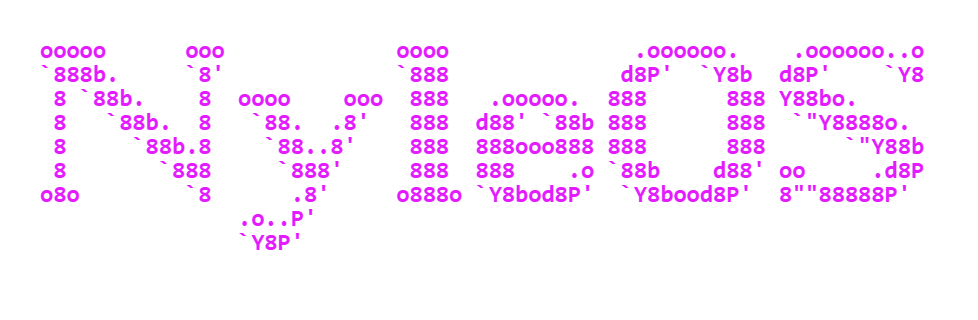

  

· · ─ ·✶· ─ · ·

Hello there! What brings you here?

My name is Nyle, it's a pleasure to meet you! Here's a little introduction about me. I'm currently in my 6th semester of Software Engineering, working towards becoming a mobile software developer. I mostly work with <b>Flutter</b> and <b>Dart</b>, but lately I've also been exploring <b>C#</b> and <b>Java</b>.

One of my biggest projects so far is <b>Cognito</b>, an Android task manager designed to help students organize their studies. It's already available on the Play Store, so feel free to check it out! You can also find the source code <a href="https://github.com/NyleCoelho/Cognito">here</a>.

· · ─ ·✶· ─ · ·

 

